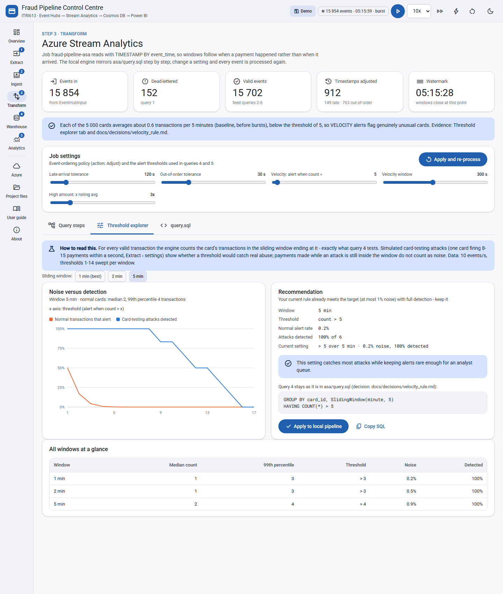

# Decision record: the velocity fraud rule

| | |
|---|---|
| **Status** | Accepted, 2026-10-15 |
| **Decision** | Keep query 4 exactly as designed (`COUNT(*) > 5` per card in a 5-minute sliding window) and spread the simulator's traffic over **5 000 cards** instead of 50 |
| **Affects** | `reference_data/card_metadata.json`, `reference_data/generate_cards.py`, `simulator/producer.py`, `ui/etl/generator.py`; follow-up: `asa/query.sql` query 5, `ui/etl/alerts.py` |
| **Evidence** | `docs/decisions/velocity_study_results.md` (reproduce with `python -m ui.etl.velocity_study`), Control Centre: Transform > Threshold explorer |

## 1. Context

Query 4 in `asa/query.sql` raises a `VELOCITY` alert when one card makes more than 5 transactions within 5 minutes. The rule targets **card testing**: a fraudster who has stolen card numbers fires many small payments in quick succession to find out which cards work.

The simulator originally sent 10 events per second (50 during bursts) over a pool of only **50 cards**. Each card therefore paid about once every 5 seconds, roughly 17 000 times a day. A real card is used a few times a day.

## 2. Problem

While mirroring the pipeline in the Control Centre, the rule was found to fire on almost every transaction. A normal card made a median of **79 transactions per 5-minute window**, so "more than 5" was always true. The `fraud_alerts` container filled with noise, the Power BI "Top 10 flagged cards" table flagged every card, and the rule detected nothing an analyst could act on.

The question was therefore not only "which threshold?" but "which combination of traffic, window and threshold makes the rule meaningful?"

## 3. Method

1. **Attack model.** The local generator was extended with simulated card-testing attacks: in a given second, with probability 1%, one card fires 8-15 small online payments (R5-R60). Attacks are flagged in the event log (`_attack`) so detection can be measured; they never leave the local engine.
2. **Measurement.** For every valid transaction, the engine counts the card's transactions in the sliding window ending at that transaction. This is exactly the value query 4 compares with its threshold. Two numbers are reported:
   - **Noise**: the share of normal payments that would raise an alert.
   - **Detection**: the share of attacks in which at least one payment raises an alert.
   - Payments made while an attack is still inside the window are excluded from noise, because alerting on a card that is under attack is not a false alarm.
3. **Acceptance target.** At most **1% noise** (an analyst queue can absorb that) with as high a detection rate as possible.
4. **Robustness.** Every option was run with three random seeds (11, 42, 99) on the same pipeline code, 20 minutes of simulated traffic at 10 events/s or 60 minutes at 1 event/s. A first single-seed run gave a misleading answer, which is why three seeds and the near-attack exclusion are part of the method.

## 4. Options considered

Results are averaged over three seeds; detection shows the range. Full table: `velocity_study_results.md`.

| Option | Change | Noise | Detection | Throughput demo |
|---|---|---|---|---|
| 1. Keep as is | none (50 cards, 10 events/s, > 5 in 5 min) | **98.3%** | 100% (everything alerts) | kept |
| 2. Lower the rate | 1 event/s, > 8 in 1 min | 0.32% | 95% (92-97%) | reduced to 1-5 events/s |
| 3. Short window | 10 events/s, > 10 in 5 s | 0.50% | 83% (78-90%) | kept |
| **4. More cards (chosen)** | **5 000 cards, rule unchanged** | **0.14%** | **100% (100-100%)** | **kept** |
| 4b. Fewer extra cards | 1 000 cards, rule unchanged | 31.9% | 100% | kept |

### Option 1: keep as is
- **For:** no work; the throughput and burst demo stays at 10-50 events/s.
- **Against:** the rule fires on 98% of normal payments, so it is a load indicator, not a fraud rule. It also inflates Cosmos DB writes and makes the Power BI fraud page meaningless. Rejected.

### Option 2: lower the rate to 1 event/s, 1-minute window
- **For:** small code change; robust across seeds and window lengths (10-30 s windows reached 100% detection).
- **Against:** throughput falls to 1-5 events/s, weakening the ingestion, partitioning and scaling evidence (rubric criteria 3 and 7). Per-card traffic (one payment a minute) is still unrealistic. Rejected in favour of Option 4, kept as the fallback.

### Option 3: keep 10 events/s, 5-second window
- **For:** keeps throughput; one-line SQL change.
- **Against:** the evidence is circular, because the window is tuned to the simulated attack shape (all payments within one second), so a slower attack would be missed. A 5-second window is also shorter than the 30-second out-of-order tolerance, so timestamp adjustment can bunch events together. Hardest to defend. Rejected.

### Option 4: 5 000 cards, rule unchanged (chosen)
- **For:** the query designed in `asa/query.sql` stays exactly as it is. Throughput stays at 10-50 events/s. Per-card behaviour becomes realistic (a median of about one payment per card per 5 minutes). Noise falls to 0.14% with every attack detected. Load spreads over more partition keys, which strengthens the `card_id` partitioning argument. It is also the clearest explanation for the report: the rule was right, the test population was too small.
- **Against:** the reference file grows from 50 to 5 000 cards (about 590 KB, still a small reference input). Each card has fewer transactions, so the Card detail drill-through is sparser. Most importantly, the amount-anomaly rule (query 5) lost its per-card history; this was fixed by a follow-up decision (section 6).

### Option 4b: 1 000 cards
Recorded to show sensitivity: with only 1 000 cards the same rule still has 32% noise. The threshold would have to rise to about 10, so the pool size matters.

*Figure: Threshold explorer on the Demo session after the change (5 000 cards, 10 events/s, 20 simulated minutes). With the rule unchanged (more than 5 in 5 minutes), 0.2% of normal payments alert and every simulated attack is caught.*

## 5. Decision

Adopt **Option 4**:

- `reference_data/generate_cards.py` produces `card_metadata.json` with 5 000 cards. The original 50 hand-written cards are kept unchanged; 4 950 more use South African names, the original tier proportions (about 53% Standard, 31% Gold, 16% Platinum) and the original credit-limit ranges. It is seeded, so it produces the same file every time.
- `simulator/producer.py` and the Control Centre's generator both read their card pool from `card_metadata.json`, so the event stream and the reference data can no longer drift apart and every event joins in query 6.
- `asa/query.sql` query 4 is **unchanged**: `GROUP BY card_id, SlidingWindow(minute, 5) HAVING COUNT(*) > 5`.

## 6. Consequences

- **Azure:** upload the new `card_metadata.json` to the `reference-data` container (`infra/deploy.ps1` does this with `--overwrite`). The reference input uses a fixed path (no date/time pattern), so Stream Analytics reads it when the job starts: restart the job after uploading.
- **Power BI:** VELOCITY alerts now identify specific cards, so the Top 10 table and its red-row threshold (more than 5 alerts) become a real analyst queue.
- **Partitions:** 5 000 keys hashed over 4 partitions give an even spread; hot partitions now require a genuinely busy card.
- **Cosmos DB writes:** query 2 writes one document per active card per minute. With 5 000 cards almost every payment opens its own window, so in 20 simulated minutes the Demo session produced 13 748 card-window documents instead of about 1 000 (roughly 11 per second instead of 1). At about 6-10 RU per small write that is roughly 70-110 RU/s, still within the `aggregates` container's 400 RU/s. Watch the container's normalised RU consumption during bursts (50 events/s), which can reach 400 RU/s; raise throughput or lengthen the window if writes are throttled (HTTP 429).
- **Live result in the Control Centre (Demo session, 5 000 cards, 20 simulated minutes):** 74 VELOCITY alerts instead of 8 995 with 50 cards; at `> 5` in 5 minutes the Threshold explorer reports 0.17% noise and 100% of attacks caught.
- **Control Centre:** the Reference data tab is searchable and paged, and the Card detail picker accepts any of the 5 000 ids.

### Follow-up decision: the amount-anomaly rule (query 5), accepted 2026-10-15

**Problem.** Query 5 alerted when a payment exceeded 3 times the **same card's** average over the previous 10 minutes. With 5 000 cards a card rarely has other payments in that window, so a large payment was mostly compared with itself (ratio 1) and missed.

**Decision.** Compare each payment with the 10-minute average of its **merchant category across all cards**, and calculate that average once a minute instead of per payment:

- Step 0 in `asa/query.sql`, `WITH CategoryAvg`, emits one row per category per minute: `AVG(amount)` over a 10-minute hopping window with a 1-minute hop. Stream Analytics requires every `WITH` step before the first `SELECT ... INTO`, so it sits at the top of the file.
- Query 5 joins each payment to the window that ended in the minute before it (`DATEDIFF(second, a, curr) BETWEEN 0 AND 59`, exactly one row) and alerts when `amount > 3 x category_avg`. The alert also records `baseline_count` and `baseline_window_end`, so an analyst can see what it was compared with.
- The threshold (3x) and the 10-minute span are unchanged. The local engine mirrors this in `ui/etl/alerts.py` (`category_amount_alerts`).

This was decided in two steps on 2026-10-15. First, the baseline moved from the card to the category, as a rolling self-join. Then, after measuring the cost of that join, the category average was pre-aggregated. Both steps are in the evidence below.

**Evidence** (`docs/decisions/amount_rule_results.md`, reproduce with `python -m ui.etl.amount_study`; injected fraud spikes, three seeds, 20 simulated minutes each at 10 events/s):

| Cards | Baseline | Spikes caught | False alerts | Rows joined per payment |
|---|---|---|---|---|
| 50 | Card's own rolling average (original) | 237 of 242 (98%) | 0.09% | 123 |
| 50 | Category rolling average, self-join | 239 of 242 (99%) | 0.06% | 870 |
| 50 | **Category average, pre-aggregated (deployed)** | 237 of 242 (98%) | 0.07% | **1** |
| 5 000 | Card's own rolling average (original) | **33 of 242 (14%)** | 0.07% | 2 |
| 5 000 | Category rolling average, self-join | 234 of 242 (97%) | 0.05% | 876 |
| 5 000 | **Category average, pre-aggregated (deployed)** | **234 of 242 (97%)** | **0.05%** | **1** |

**Pros.**
- Detection no longer depends on how often a single card is used (97% at 5 000 cards, 98% at 50).
- Each category has a large, stable history (about 850 payments per 10 minutes at 10 events/s), so one payment cannot distort its own baseline.
- The cheapest join of all the options: one row per payment, against 876 for the rolling self-join and 123 for the original per-card rule with 50 cards. Query 5 no longer competes with the other queries for streaming units, so it does not slow down the dead-letter, window, velocity or enrichment outputs.

**Cons and trade-offs.**
- **Meaning changes.** An alert now means "unusual for this kind of purchase", not "unusual for this customer". A customer who always spends R5 000 on travel will alert if the travel average is R600. Query 6's `credit_flag` (NEAR_LIMIT) and the card tier help an analyst separate genuine high spenders from fraud.
- **Slightly stale baseline.** The average comes from the last completed minute, so it excludes the current payment and up to 59 seconds of the most recent payments. With hundreds of payments per category in each window, this made no measurable difference to detection (97% either way at 5 000 cards).
- **Cross-partition.** `CategoryAvg` groups by category across every `card_id` partition, so it cannot run per partition. At 1 SU the job is not partition-parallel anyway; it would matter only when scaling out.

## 7. Limitations and how to revisit

- The fraud-spike model (one payment 8-25 times larger than usual) is also an assumption; it drives the query 5 numbers above. Re-run with `python -m ui.etl.amount_study`.

- The attack model (8-15 payments within one second) is an assumption. Slower card testing, for example one payment every 30 seconds, would need its own study. The Threshold explorer and `velocity_study.py` make that a quick experiment.
- All figures come from the local mirror of the Stream Analytics query, not from Azure. Once the job runs on Azure, compare the share of VELOCITY alerts in `fraud_alerts` against the expected 0.1-0.2% of transactions.
- To re-run the evidence: `python -m ui.etl.velocity_study` (about 30 seconds). To explore interactively: Control Centre > Transform > Threshold explorer.